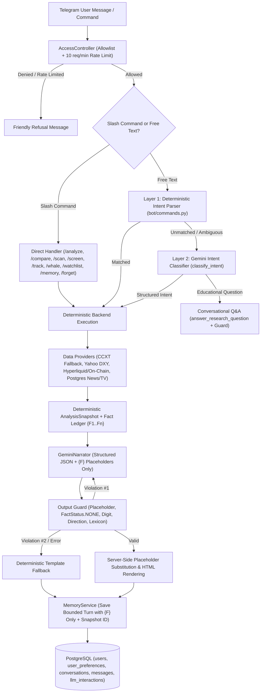

# Chat, Memory, and Data Acquisition Architecture

This document explains how `crypto-chatbot` processes Telegram chat messages, manages bounded conversation memory and user preferences, enforces LLM safety boundaries, and acquires market, macro, whale, and sentiment data.

---

## 1. End-to-End Message & Data Flow

---

## 2. How Chat Works

### 2.1 Access Control & Rate Limiting (`src/crypto_chatbot/bot/access.py`)
Every incoming command and free-text message passes through `BotService._authorize()` → `AccessController.check_access(user_id)`:
- **Closed Allowlist**: Only numeric `telegram_user_id`s configured in `ALLOWED_TELEGRAM_USER_IDS` are accepted.
- **Sliding-Window Per-User Rate Limit**: Default is **10 requests per 60 seconds** per user (`RATE_LIMIT_PER_MINUTE`). The 11th request within the window is rejected with `reason="rate_limited"` and a polite Indonesian cooldown message.
- **Secret Redaction**: `SecretRedactingFilter` is attached to the root logger at startup (`app.py`), and `httpx`/`httpcore` loggers are raised to `WARNING` so Telegram Bot API tokens and Gemini keys are never logged.

### 2.2 Supported Telegram Commands (`src/crypto_chatbot/bot/handlers.py`)
| Command | Behavior |
| :--- | :--- |
| `/start`, `/help` | Onboarding message, usage examples, and non-financial-advice disclaimer. |
| `/analyze <SYMBOL> [TF=4h]` | Deterministic technical, SMC, derivatives, macro, and conditional setup analysis + validated Gemini narration. |
| `/compare <SYM1> <SYM2> [SYM3] [TF]` | Side-by-side descriptive comparison across 2–3 perpetual pairs. |
| `/scan [SYMBOLS] [TF]` | Multi-asset or multi-style (`15m` / `1h` / `4h`) setup scanner. |
| `/screen` or `/screener [long\|short]` | 15m momentum screener over high-volume top gainers/losers (tagged `[UNVALIDATED]` until §7.8 validation criteria pass). |
| `/track` | Forward-evaluation ledger summary per timeframe (`MET`/`NOT_MET`, settled count, expectancy, 95% block-bootstrap CI). |
| `/pine <SYMBOL> [TF]` | Generates a TradingView Pine Script v6 overlay matching deterministic backend levels. |
| `/whale [SYMBOL\|add\|remove\|list\|<address>]` | Hyperliquid perpetual whale positioning overview and on-chain wallet flow tracker. |
| `/watchlist [add\|remove <SYMBOL>]` | Manages the user's explicit symbol watchlist in `user_preferences`. |
| `/memory` | Displays the user's stored preferences and bounded recent message count. |
| `/forget` | Permanently deletes all user-scoped preferences, conversations, messages, and LLM interaction logs. |

### 2.3 Hybrid 2-Layer NLP Routing for Free-Text Chat
When a user sends natural-language text (without a `/` prefix), `BotService.handle_text_message()` runs a two-layer pipeline:

1. **Layer 1 — Deterministic Parser (`resolve_followup_intent` in `src/crypto_chatbot/bot/commands.py`)**
   - Costs **zero** LLM tokens and executes instantaneously.
   - Extracts symbols (aliases like `BTC`/`Bitcoin`, `ETH`, `SOL`, explicit `XYZ/USDT` or `XYZUSDT`, or action cues like `"analisa DOGE"` while filtering out `_NON_TICKER_ACRONYMS` such as `RSI`, `EMA`, `SMC`, `FVG`, `BOS`, `CHOCH`).
   - Extracts explicit timeframes (`15m`, `1h`, `4h`, `1d`) or trading style keywords (`scalp` → `15m`, `intraday` → `1h`, `swing` → `4h`, `position trade` → `1d`).
   - Resolves follow-up context using `_extract_recent_context(recent_messages, default_timeframe)` so queries like `"bandingkan momentumnya dengan ETH"` automatically reuse the last analyzed symbol (`BTC/USDT:USDT`) and timeframe (`4h`) from memory.
   - Detects hard out-of-scope requests (order execution, guaranteed profit claims, personalized capital allocation) and returns an immediate `RefusalIntent`.

2. **Layer 2 — LLM Intent Classifier Fallback (`_resolve_via_llm_fallback` → `GeminiNarrator.classify_intent`)**
   - Triggered only when Layer 1 cannot confidently classify the message (e.g., lowercase unknown tickers like `"vvv sekarang gimana?"` or open-ended educational questions).
   - Receives only the sanitized user message (wrapped in `<untrusted_data>` tags) and up to 3 recent symbol names—never raw database records or secrets.
   - Routes to `AnalyzeIntent`, `CompareIntent`, `ScanIntent`, `ScreenIntent`, `PineIntent`, `WhaleIntent`, `RefusalIntent`, or `ChatQaIntent`.

3. **Educational Q&A Path (`_execute_chat_qa`)**
   - For conceptual questions (e.g., `"bedanya CHoCH sama BOS apa?"`), calls `GeminiNarrator.answer_research_question()` with bounded topic context.
   - Validated by `validate_conversational_answer()` (blocks overconfidence lexicon, direct order instructions, fabricated live prices, URLs, and secret patterns).

### 2.4 Strict LLM Narration Boundary & Output Guard (`src/crypto_chatbot/llm/`)
Gemini **never** computes indicators, setups, or numbers:
1. Deterministic Python builds an immutable `AnalysisSnapshot` containing a fact ledger `F1..Fn` (each with `value`, `unit`, `display_format`, `source`, `as_of`, and `status ∈ {OK, DEGRADED, NONE}`).
2. `GeminiNarrator.narrate_snapshot()` enforces per-user and global UTC daily call caps (`DailyQuotaTracker`) and sends only fact metadata + qualitative labels to Gemini, requesting structured JSON (`LlmAnalysisNarration`) with `{F<n>}` placeholders.
3. `validate_narration()` in `src/crypto_chatbot/llm/guard.py` checks every generated field before rendering:
   - **Placeholder & Status Check**: Rejects malformed braces, unknown `{F99}`, or any fact with `status == FactStatus.NONE`.
   - **Raw Digit Scan**: Strips valid `{F<n>}` placeholders and server-built allowlist tokens (snapshot symbol tickers like `1000PEPE`, timeframes like `4h`, indicator period labels like `EMA 200`, `RSI 14`, `TP1`–`TP3`), then rejects any remaining `[0-9]` digit.
   - **Directional Consistency Check**: Rejects bias words (`bullish`/`long` vs `SHORT`, or `bearish`/`short` vs `LONG`) in the summary that contradict a `READY` setup's bias.
   - **Compliance & Security Check**: Rejects overconfidence lexicon (`pasti`, `dijamin`, `guaranteed`, `sure win`, etc.), URLs, unsupported pair mentions, and secret patterns.
4. **Retry-then-Fallback**: Every violation is logged with `violation_type` and `model_version`. On the first violation, `GeminiNarrator` retries **once** with `[GUARD_RETRY_FEEDBACK]`. On a second violation (or timeout/quota exhaustion), it falls back cleanly to the deterministic Indonesian template (`NarrationStatus.FALLBACK_DETERMINISTIC`).
5. **Server-Side Rendering**: `render_analysis_response()` substitutes `{F<n>}` placeholders with backend-formatted values and splits output safely under Telegram's 4,096-character limit.

---

## 3. How Memory Works

Conversation memory is managed by `MemoryService` (`src/crypto_chatbot/memory/service.py`) backed by `PostgresUserMemoryRepository` (`src/crypto_chatbot/storage/repositories.py`).

### 3.1 Core Memory Invariants (ADR 0001)
1. **Strictly User-Scoped & Zero PII**: Users are keyed only by numeric `telegram_user_id`. No names, usernames, phone numbers, or inferred financial profiles are stored.
2. **Bounded Sliding Window**: Each user retains at most `MAX_RECENT_MESSAGES = 20` recent messages, and each stored message is truncated to `MAX_STORED_USER_MESSAGE_CHARS = 1000` characters. Older turns beyond 20 are automatically pruned on insert.
3. **No LLM Memory Summarization**: The system never asks an LLM to summarize past conversations into long-term memory, preventing compounding hallucinations.
4. **No Rendered Market Numbers in Assistant Memory**: When storing an analysis or comparison turn (`record_assistant_turn` / `record_comparison_turn`), `MemoryService` stores **only**:
   - The symbol/timeframe header (e.g., `[BTC/USDT:USDT 4h]`),
   - The raw `{F<n>}` placeholder summary (if validated) or deterministic status text, and
   - The immutable `snapshot_id` reference.
   - Rendered prices (e.g., `65.577,38 USDT`) are **never** written into `messages.content`, guaranteeing stale prices cannot leak into future Gemini prompts.

### 3.2 Memory & Audit Tables (`src/crypto_chatbot/storage/models.py`)
| Table | Purpose | Key Fields |
| :--- | :--- | :--- |
| `users` | Minimal user identity | `telegram_user_id` (PK), `is_allowlisted`, `created_at` |
| `user_preferences` | Explicit user settings | `telegram_user_id` (FK CASCADE), `watchlist` (JSONB), `language` (`"id"`), `default_timeframe` (`"4h"`), `display_currency` (`"USDT"`) |
| `conversations` | Per-user conversation thread | `id`, `telegram_user_id`, `created_at`, `updated_at` |
| `messages` | Bounded chat turns (max 20/user) | `conversation_id` (FK CASCADE), `telegram_user_id`, `role` (`user`/`assistant`), `content`, `snapshot_id`, `created_at` |
| `llm_interactions` | Audit trail of Gemini calls (no secrets) | `telegram_user_id`, `request_id`, `snapshot_id`, `model_id`, `prompt_version`, `validation_passed`, `rejection_reasons`, `prompt_tokens`, `output_tokens`, `latency_ms` |
| `whale_watchlist` | User-tracked whale wallet addresses | `address`, `label`, `network`, `created_at` |

### 3.3 How Memory Feeds Back Into Chat
- **Topic & Follow-up Resolution**: `get_recent_messages(user_id)` is passed to `_extract_recent_context()` so follow-up phrases (`"gimana ETH?"`, `"cek 15m"`, `"bandingkan dengan SOL"`) resolve against the user's recent symbol/timeframe without asking the user to repeat everything.
- **Non-Authoritative LLM Context**: `MemoryService.build_context_for_llm()` formats recent turns under the explicit header:
  > `"Riwayat percakapan terbatas (hanya konteks topik; BUKAN fakta pasar saat ini):"`
  Even if Gemini attempts to echo a number from a previous user message, `validate_narration()` rejects it via the raw-digit guard.
- **Deletion & Retention**:
  - `/forget` calls `MemoryService.forget_user(user_id)`, cascading deletes across `user_preferences`, `conversations`, `messages`, and `llm_interactions`, while leaving public market data and anonymous snapshots intact.
  - `crypto-chatbot purge-expired` enforces configurable retention windows for old messages, interactions, and snapshots.

---

## 4. Data Acquisition: Where Every Data Source Comes From

All external market data is fetched asynchronously, normalized into strict UTC Pydantic schemas, validated for closed-candle causality (`available_time <= as_of`), and persisted/audited in PostgreSQL.

| Data Domain | Source / Provider | Implementation | Details, Fallback & Caching |
| :--- | :--- | :--- | :--- |
| **Perpetual & Spot OHLCV Candles** | **CCXT Multi-Exchange Chain** (configured via `FUTURES_EXCHANGE` / `FUTURES_EXCHANGE_CHAIN`, e.g., `bingx`, `binance`, `bybit`, `okx`, `bitget`, `gateio`) | `CcxtMarketDataProvider`, `FallbackMarketDataProvider` (`src/crypto_chatbot/market_data/ccxt_provider.py`, `fallback_provider.py`) | Tries exchanges in priority order until one succeeds. Drops unclosed candles (`close_time > now`). Supports paginated historical backfill up to `10,000` closed candles (`get_closed_ohlcv_history`). Cached in `AnalysisService` for **45 seconds** per `(symbol, timeframe)`. |
| **Derivatives & Microstructure** (Funding Rate, Funding History, Open Interest, L2 Order Book, Liquidations) | **CCXT Futures Exchange Chain** + optional **Bybit** secondary venue | `CcxtDerivativesLiquidityProvider` (`derivatives_provider.py`), `BybitDerivativesProvider` (`bybit_derivatives.py`) | Primary derivatives fetched from the active exchange chain (including `get_funding_history` for signed historical funding). When Binance is in the chain, Bybit is queried concurrently for cross-venue funding dispersion and mark-price spread (`cross_venue.py`). |
| **Macro Context (US Dollar Index / DXY)** | **Yahoo Finance Public Chart API** (`https://query1.finance.yahoo.com/v8/finance/chart/DX-Y.NYB`) | `DxyMarketDataProvider` (`macro_provider.py`), `build_macro_benchmark_context` (`analysis/macro.py`) | 3-second HTTP timeout, in-memory cache per timeframe, automatic FX weekend closure detection (Fri 22:00 UTC – Sun 22:00 UTC), and backward point-in-time as-of join (72h max staleness for `1d` to span weekends; `2 * Δt` for intraday). Tagged `CONTEXT_ONLY` (never a setup gate). |
| **Whale Positioning & On-Chain Flows** | **Hyperliquid Public Clearinghouse API** & **Public Blockchain Explorers** (EVM / Bitcoin / Solana) | `WhaleDataProvider` (`whale_provider.py`), `WhaleWatchlistManager` (`analysis/whale_tracker.py`) | Aggregates live perpetual positions across curated institutional/vault addresses (`CURATED_HYPERLIQUID_WHALES`) plus user-added wallets, and tags inflows/outflows against curated CEX hot/cold wallets (`KNOWN_CEX_WALLETS`). Tagged `FORWARD_ONLY`. |
| **Crypto News & Sentiment** | **RSS 2.0 / Atom Feeds** (or recorded JSON fixtures) + Deterministic Lexicon Scorer | `news/pipeline.py` (`parse_rss_xml`, `deduplicate_articles`, `build_sentiment_observations`, `aggregate_sentiment`) | Strips tracking params, deduplicates by canonical URL and content fingerprint, matches entities with confidence `>= 0.65`, and scores using `crypto-lexicon-v1.0.0` (`scorer_class="lexicon_deterministic"`). Point-in-time eligibility enforces `available_time <= as_of` and `scored_at <= as_of`; LLM backfill is strictly blocked. |
| **TradingView Signals** | **TradingView Webhook** (AI Agent Lens sanitized packets) | `market_data/tradingview.py`, `PostgresTradingViewRepository` | Validated by shared secret / idempotency key, sanitized before persistence in `tradingview_packets`, and joined causally by `available_time <= as_of`. |
| **Local Persistence & Research Ledgers** | **PostgreSQL** (local instance via `DATABASE_URL`) | `storage/models.py`, `storage/repositories.py` | Stores normalized candles (`market_candles`), immutable snapshots (`analysis_snapshots`), derivatives observations, setup forward ledger (`setup_calibrations`), trial registry (`trials`), ML experiments (`ml_experiments`), shadow predictions (`model_predictions`), and daily screener universe snapshots (`screener_universe_snapshots`). |

### 4.1 Point-in-Time & Data Quality Guarantees
- **Closed Candles Only**: Any candle whose `close_time > now` is discarded before entering indicators, SMC, setup generation, or ML features.
- **UTC Internally**: Every timestamp is stored and compared in timezone-aware UTC; WIB (`UTC+7`) is formatted only at the final Telegram presentation layer.
- **Honest Failure (`INSUFFICIENT_DATA` / `DEGRADED`)**: If an exchange is unreachable across the entire fallback chain, history is too short (e.g., `< 600` bars for EMA 200), or optional feeds (derivatives/DXY/news) fail, the system never invents or silently interpolates values—it either downgrades quality flags transparently or returns `INSUFFICIENT_DATA` / `WAIT`.
