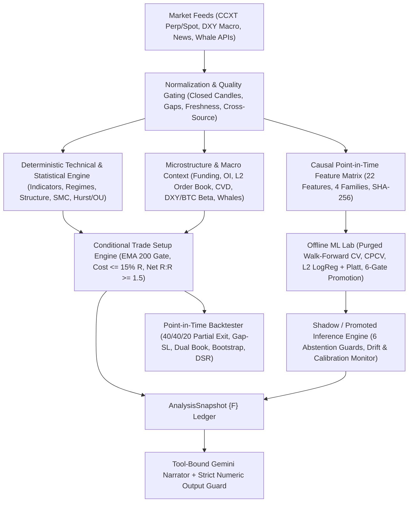

# Product Requirements Document (PRD): Quantitative Analysis, Machine Learning & Backtesting Engine

**Product**: `crypto-chatbot` (Deterministic Crypto Market Research Assistant)
**Document Version**: `1.6.0` (Aligned with `CALC_VERSION = "1.6.0"`, `FEATURE_VERSION = "ml-feat-v1.1.0"`, `MODEL_VERSION = "l2-logreg-platt-v1.0.0"`)
**Scope**: Mathematical & Quantitative Analytics, Deterministic Trade Setup Engine, Offline & Shadow Machine Learning Pipeline, Anti-Overfitting Statistics, and Point-in-Time Replay Backtester.
**Binding References**: `PROJECT_PLAN.md`, `AGENTS.md`, `docs/decisions/0001`–`0009`.

---

## 1. Executive Summary & Core Product Principles

### 1.1 Product Vision
`crypto-chatbot` is a research and educational assistant for cryptocurrency perpetual futures and spot markets. Its core architectural separation is strict:

> **Deterministic Python computes 100% of market facts, indicators, statistical estimators, trade setups, ML probabilities, and backtest evaluations. The LLM (Gemini) is a strictly tool-bound narrator that explains validated backend facts via `{F<n>}` placeholders and never calculates or invents numbers.**

### 1.2 Non-Negotiable Quantitative & Safety Invariants
1. **Closed Candles Only**: Every indicator, pivot, SMC event, feature row, and backtest evaluation strictly rejects open/in-progress candles (`is_closed == True` and `close_time <= as_of`).
2. **Point-in-Time Causality**: No observation may be used prior to its `available_time` (`available_time <= prediction_time` is enforced by schema validators and fold-leakage assertions). All internal timestamps are timezone-aware UTC.
3. **Explicit `INSUFFICIENT_DATA` Over Silent Imputation**: Missing history, stale feeds, gaps, or severe cross-source price mismatches return explicit `INSUFFICIENT_DATA` / `DEGRADED` flags or `WAIT` setups rather than silently guessing or fabricating zeros.
4. **Non-Probabilistic Rules vs. Calibrated ML**: Deterministic indicator, regime, and SMC rules are measurements, never success probabilities (`is_probabilistic = False`). Only offline-validated, Platt-calibrated ML artifacts produce probabilities—and only after passing strict out-of-sample and holdout promotion gates.
5. **No Automated Execution**: No exchange private keys, no order placement, no personalized portfolio allocation, and no LLM-generated price targets.

### 1.3 End-to-End Quantitative Architecture

---

## 2. Data Integrity, Temporal Causality & Quality Gating

**Primary Modules**: `src/crypto_chatbot/market_data/base.py`, `ccxt_provider.py`, `quality.py`, `derivatives_quality.py`, `orderbook.py`

### 2.1 Temporal & Pagination Contracts
- Every candle carries `open_time`, `close_time`, `received_time`, and `available_time` (all UTC).
- **Live analysis fetch cap**: `DEFAULT_CANDLE_LIMIT = 1000`, `MAX_CANDLE_LIMIT = 1000`.
- **Historical backtest pagination**: `MAX_HISTORY_CANDLE_LIMIT = 10,000` (`get_closed_ohlcv_history`), paginating forward in chunks of up to `1,000` bars with hard page bound (`max_pages = 60`), timestamp deduplication, and contiguity validation (`open_time[i] - open_time[i-1] == timeframe.duration`).

### 2.2 Minimum Warm-Up History Requirements (per-indicator constants)
Indicators return `None` until minimum closed-candle history is satisfied (`indicators.py`, `statistics.py`):

| Metric / Indicator | Min Closed Bars | Constant |
| :--- | :---: | :--- |
| 1-bar Return (`return_1`) | 2 | `MIN_HISTORY_RETURN_1` |
| 20-bar Return (`return_20`) / RelVol(20) / Realized Vol(20) | 21 | `MIN_HISTORY_RETURN_20` / `MIN_HISTORY_REL_VOL_20` / `MIN_HISTORY_REALIZED_VOL` |
| Bollinger(20) / Donchian(20) / VWAP(20) / Parkinson / Garman-Klass | 20 | `MIN_HISTORY_BOLLINGER_20`, etc. |
| OU Half-Life (min guard; default window 120) | 30 | `MIN_HISTORY_OU_HALF_LIFE` |
| ATR(14) & ATR% | 42 | `MIN_HISTORY_ATR_14` |
| RSI(14) | 43 | `MIN_HISTORY_RSI_14` |
| ADX / +DI / -DI (14) | 56 | `MIN_HISTORY_ADX_14` |
| EMA(20) | 60 | `MIN_HISTORY_EMA_20` |
| Hurst Exponent | 64 | `MIN_HISTORY_HURST` |
| MACD (12, 26, 9) | 87 | `MIN_HISTORY_MACD` |
| ATR Percentile Rank (100-bar window) | 113 | `MIN_HISTORY_ATR_PCT_100` |
| EMA(50) | 150 | `MIN_HISTORY_EMA_50` |
| EMA(200) (Full History Benchmark) | 600 | `MIN_HISTORY_EMA_200` |

### 2.3 Freshness & Quality Status Rules
- **Staleness Check**: A candle batch is flagged `STALE` when:
  $$\text{now} - \text{latest\_close\_time} > \Delta t_{\text{timeframe}} + 5\text{ min}$$
- **Cross-Source Price Consistency** (`derivatives_quality.py`):
  - Max timestamp discrepancy: $\Delta t \le 120\text{ s}$.
  - Relative price divergence $\delta_{\text{bps}} = \frac{|P_a - P_b|}{\text{mid}(P_a, P_b)} \times 10{,}000$:
    - `PRICE_MISMATCH` (`DEGRADED`) if $\delta_{\text{bps}} \ge 50\text{ bps}$.
    - `SEVERE_PRICE_MISMATCH` (`INSUFFICIENT_DATA`) if $\delta_{\text{bps}} \ge 200\text{ bps}$.
  - Open interest unit validation tolerance: `DEFAULT_OI_UNIT_TOLERANCE = 10%`; Funding max age: `15 min`.
- **Quality Status Mapping** (`quality.py`):
  - `INSUFFICIENT_DATA`: Any flag in `{STALE, INVALID_OHLC, SYMBOL_MISMATCH, GAP, PROVIDER_ERROR, SEVERE_PRICE_MISMATCH}` OR `candle_count < 150`.
  - `DEGRADED`: Any flag in `{SHORT_HISTORY, ZERO_VOLUME, FLAT_PRICE, PRICE_MISMATCH, DERIVATIVES_UNAVAILABLE, ORDERBOOK_UNAVAILABLE, UNIT_MISMATCH}` OR `candle_count < 600`.
  - `READY`: Otherwise (`candle_count >= 600` and zero blocking/degrading flags).

---

## 3. Deterministic Technical & Statistical Analysis Specification

### 3.1 Core Technical Indicators (`src/crypto_chatbot/analysis/indicators.py`)
All moving averages are strictly causal, seeded with the Simple Moving Average (SMA) of the first $p$ finite values to match TradingView (`ta.ema` / `ta.rma`) parity.

1. **Simple Return ($k$-period)**:
   $$r_t^{(k)} = \frac{C_t}{C_{t-k}} - 1 \quad (k \in \{1, 20\}, \; C_{t-k} > 0)$$

2. **Causal Smoothed Moving Averages (EMA & Wilder RMA)**:
   $$M_{s+p-1} = \frac{1}{p}\sum_{j=s}^{s+p-1} x_j, \qquad M_t = \alpha x_t + (1 - \alpha) M_{t-1}$$
   - **EMA** ($p \in \{20, 50, 200\}$): $\alpha = \frac{2}{p + 1}$.
   - **Wilder RMA** ($p = 14$): $\alpha = \frac{1}{p}$.

3. **Wilder RSI (14)**:
   With $\Delta_t = C_t - C_{t-1}$, $G_t = \max(\Delta_t, 0)$, $L_t = \max(-\Delta_t, 0)$, $\bar{G}_t = \text{RMA}_{14}(G)_t$, $\bar{L}_t = \text{RMA}_{14}(L)_t$:
   $$\text{RSI}_t = \begin{cases} 100 & \text{if } \bar{L}_t = 0 \text{ (also sets } \texttt{FLAT\_PRICE} \text{ if } \bar{G}_t = 0\text{)} \\ 0 & \text{if } \bar{G}_t = 0 \text{ and } \bar{L}_t > 0 \\ 100 - \dfrac{100}{1 + \bar{G}_t / \bar{L}_t} & \text{otherwise} \end{cases}$$

4. **MACD (12, 26, 9)**:
   $$\text{MACD}_t = \text{EMA}_{12}(C)_t - \text{EMA}_{26}(C)_t, \quad \text{Signal}_t = \text{EMA}_9(\text{MACD})_t, \quad \text{Hist}_t = \text{MACD}_t - \text{Signal}_t$$

5. **True Range, Wilder ATR(14), ATR%, and ATR Percentile Rank (100-bar)**:
   $$\text{TR}_t = \max\!\left(H_t - L_t,\; |H_t - C_{t-1}|,\; |L_t - C_{t-1}|\right)$$
   *(with $\text{TR}_0 = H_0 - L_0$ for ATR matching `ta.atr`, and $\text{TR}_0 = \text{NaN}$ for DMI matching `ta.dmi`)*
   $$\text{ATR}_t = \text{RMA}_{14}(\text{TR})_t, \qquad \text{ATR\%}_t = \frac{\text{ATR}_t}{C_t}$$
   $$\text{ATR\_PctRank}_t = \frac{100}{W - 1} \sum_{j = t-W+1}^{t} \mathbb{I}\!\left(\text{ATR\%}_j < \text{ATR\%}_t\right), \quad W = 100$$

6. **Wilder ADX / +DI / -DI (14)**:
   With $u_t = H_t - H_{t-1}$, $d_t = L_{t-1} - L_t$:
   $$+\text{DM}_t = \begin{cases} u_t & u_t > d_t \land u_t > 0 \\ 0 & \text{otherwise} \end{cases}, \qquad -\text{DM}_t = \begin{cases} d_t & d_t > u_t \land d_t > 0 \\ 0 & \text{otherwise} \end{cases}$$
   $$+\text{DI}_t = 100 \cdot \frac{\text{RMA}_{14}(+\text{DM})_t}{\text{RMA}_{14}(\text{TR})_t}, \qquad -\text{DI}_t = 100 \cdot \frac{\text{RMA}_{14}(-\text{DM})_t}{\text{RMA}_{14}(\text{TR})_t}$$
   $$\text{DX}_t = 100 \cdot \frac{|+\text{DI}_t - -\text{DI}_t|}{+\text{DI}_t + -\text{DI}_t}, \qquad \text{ADX}_t = \text{RMA}_{14}(\text{DX})_t$$

7. **Relative Volume (20-bar, excluding current bar $t$)**:
   $$\text{RVol}_t = \frac{V_t}{\frac{1}{20}\sum_{j=t-20}^{t-1} V_j}$$
   *(Flags `ZERO_VOLUME` and returns `None` when denominator is zero.)*

8. **Bollinger Bands (20, $k=2.0$, population $\text{ddof}=0$)**:
   $$\mu_t = \frac{1}{20}\sum_{j=t-19}^{t} C_j, \quad \sigma_t = \sqrt{\frac{1}{20}\sum_{j=t-19}^{t} (C_j - \mu_t)^2}, \quad U_t = \mu_t + 2\sigma_t, \quad L_t = \mu_t - 2\sigma_t$$
   $$\%B_t = \frac{C_t - L_t}{U_t - L_t} \quad (0.5 \text{ if flat}), \qquad \text{Bandwidth}_t = \frac{U_t - L_t}{\mu_t}$$

9. **Donchian Channel (20-bar)**:
   $$U^{\text{DC}}_t = \max_{j \in [t-19, t]} H_j, \qquad L^{\text{DC}}_t = \min_{j \in [t-19, t]} L_j, \qquad M^{\text{DC}}_t = \frac{U^{\text{DC}}_t + L^{\text{DC}}_t}{2}$$

10. **Rolling Volume-Weighted VWAP (20-bar) & Z-Score**:
    With typical price $TP_j = \frac{H_j + L_j + C_j}{3}$ and weights $w_j = \frac{V_j}{\sum_{m=t-19}^t V_m}$:
    $$\text{VWAP}_t = \sum_{j=t-19}^{t} w_j TP_j, \qquad \sigma_{\text{vw}, t} = \sqrt{\sum_{j=t-19}^{t} w_j (TP_j - \text{VWAP}_t)^2}$$
    $$U^{\text{VWAP}}_t = \text{VWAP}_t + 2\sigma_{\text{vw}, t}, \qquad L^{\text{VWAP}}_t = \text{VWAP}_t - 2\sigma_{\text{vw}, t}, \qquad Z^{\text{VWAP}}_t = \frac{C_t - \text{VWAP}_t}{\sigma_{\text{vw}, t}}$$

11. **Multi-Timeframe RSI(14) Alignment** (`1h`, `4h`, `1d`):
    Using only candles with `close_time <= as_of` (or `available_time <= as_of`):
    - `ALIGNED_BULLISH` if $\text{RSI}_{14} > 50$ on all 3 timeframes.
    - `ALIGNED_BEARISH` if $\text{RSI}_{14} < 50$ on all 3 timeframes.
    - `MIXED` otherwise (`None` if any timeframe lacks 43 closed candles).

12. **Previous Complete Period Levels**:
    Exact high/low/close of the prior complete UTC day and prior complete ISO week (Monday 00:00 UTC boundary), requiring contiguous bars covering 100% of the period (`None` if any bar is missing).

---

### 3.2 Model-Free Statistical Estimators (`src/crypto_chatbot/analysis/statistics.py`)

1. **Log Returns & Close-to-Close Realized Volatility ($W=20$, $\text{ddof}=1$)**:
   $$\ell_t = \ln\!\left(\frac{C_t}{C_{t-1}}\right), \qquad \hat{\sigma}_{\text{cc}} = \sqrt{\frac{1}{W - 1}\sum_{j=t-W+1}^{t} (\ell_j - \bar{\ell})^2}$$
   Timeframe-aware annualization (crypto 24/7, 365 days/year):
   $$\hat{\sigma}_{\text{cc, ann}} = \hat{\sigma}_{\text{cc}} \cdot \sqrt{\frac{365 \times 86{,}400}{\Delta t_{\text{sec}}}}$$

2. **Parkinson High-Low Range Volatility ($W=20$)**:
   $$\hat{\sigma}_P = \sqrt{\frac{1}{4 \ln 2} \cdot \frac{1}{W}\sum_{j=t-W+1}^{t} \left(\ln \frac{H_j}{L_j}\right)^2}$$

3. **Garman-Klass OHLC Volatility ($W=20$)**:
   $$\hat{\sigma}_{GK} = \sqrt{\frac{1}{W}\sum_{j=t-W+1}^{t} \left[\frac{1}{2}\left(\ln \frac{H_j}{L_j}\right)^2 - (2 \ln 2 - 1)\left(\ln \frac{C_j}{O_j}\right)^2\right]}$$

4. **Hurst Exponent ($H \in [0, 1]$, $\min 64$ bars, lags $\tau \in \{2, \dots, 20\}$)**:
   With $y_t = \ln C_t$ and sample std $s(\tau) = \text{std}_{\text{ddof}=1}(y_{t+\tau} - y_t)$, regress $\ln s(\tau)$ on $\ln \tau$ via OLS:
   $$H = \operatorname{clip}_{[0, 1]}\!\left(\text{slope}\big(\ln \tau,\; \ln s(\tau)\big)\right)$$
   - $H < 0.5$: mean-reverting; $H \approx 0.5$: random walk; $H > 0.5$: persistent/trending.

5. **Ornstein-Uhlenbeck Mean-Reversion Half-Life ($W=120$ bars)**:
   Fit OLS $\Delta y_t = \alpha + \beta y_{t-1} + \varepsilon_t$ on $y_t = \ln C_t$. Defined only when $-1 < \beta < 0$:
   $$t_{1/2} = -\frac{\ln 2}{\ln(1 + \beta)} \quad (\text{bars})$$
   Returns `None` if $\beta \ge 0$ (non-mean-reverting).

---

### 3.3 Market Regime & Volatility Regime Classification (`src/crypto_chatbot/analysis/regimes.py`)

1. **5-State Deterministic Market Regime** (strict evaluation priority):
   - Requires finite `atr_percentile_100`, `adx_14`, `plus_di_14`, `minus_di_14`, `ema_50`; else `None`.
   1. $\text{ATR\_PctRank}_{100} \ge 80.0 \implies$ `HIGH_VOLATILITY`
   2. $\text{ADX}_{14} \ge 25.0 \land +\text{DI}_{14} > -\text{DI}_{14} \land C_t > \text{EMA}_{50} \implies$ `TRENDING_UP`
   3. $\text{ADX}_{14} \ge 25.0 \land -\text{DI}_{14} > +\text{DI}_{14} \land C_t < \text{EMA}_{50} \implies$ `TRENDING_DOWN`
   4. $\text{ADX}_{14} < 20.0 \implies$ `RANGING`
   5. Otherwise $\implies$ `TRANSITIONAL`

2. **3-State Realized Volatility Regime**:
   Computes trailing `100` rolling 20-bar $\hat{\sigma}_{\text{cc}}$ samples (`min_required = 120` bars) and ranks the current value (`percentile` $\in [0, 100]$):
   - `LOW` if $\text{percentile} \le 30.0$; `HIGH` if $\text{percentile} \ge 70.0$; `NORMAL` otherwise.

---

### 3.4 Causal Market Structure, Hybrid SMC & Failed Breakouts

**Modules**: `structure.py`, `smc.py`, `failed_breakout.py`

1. **Confirmed $k$-Bar Swing Pivots ($k=3$)**:
   - Bar $i$ is a `SWING_HIGH` iff $H_i > \max_{j \in [i-k, i+k]\setminus\{i\}} H_j$ (symmetric for `SWING_LOW`).
   - **Zero-Lookahead Confirmation**: `event_time = candles[i].close_time`, while **`confirmation_time = candles[i+k].close_time`**. No downstream logic may observe pivot $i$ before bar $i+k$ closes.
2. **Market Structure**: From the last two confirmed swing highs $(SH_1, SH_2)$ and lows $(SL_1, SL_2)$:
   - `BULLISH` if $SH_2 > SH_1 \land SL_2 > SL_1$; `BEARISH` if $SH_2 < SH_1 \land SL_2 < SL_1$; else `MIXED`.
3. **Causal Liquidity Sweeps & BOS / CHoCH** (`smc.py`):
   - `LIQUIDITY_SWEEP_BEARISH`: $H_t > SH_{\text{latest}} \land C_t \le SH_{\text{latest}}$ (wick pierce + close back inside; symmetric for bullish). Active only if occurred within last `SWEEP_RECENT_BARS = 10` bars.
   - `BOS` / `CHoCH`: Close beyond an unconsumed confirmed swing ($C_t > SH_{\text{latest}}$ or $C_t < SL_{\text{latest}}$). Transitions against prior directional state emit `CHOCH_*`; continuations emit `BOS_*`.
4. **Active Fair Value Gaps (FVG, lookback 50 bars)**:
   - Bullish FVG at $(i-2, i-1, i)$ if $L_i > H_{i-2}$ and width $\frac{L_i - H_{i-2}}{C_i} \times 10{,}000 \ge 10\text{ bps}$, unmitigated ($\forall j > i: L_j > H_{i-2} \land C_j \ge H_{i-2}$), and $L_i \le 1.002 \cdot C_{\text{last}}$ (symmetric for Bearish FVG).
5. **Active Order Blocks (OB, lookback 50 bars, pre-break scan 10 bars)**:
   - Bullish OB: Most recent bearish candle ($C < O$) within 10 bars prior to a bullish BOS/CHoCH, unmitigated ($\forall j > \text{break\_idx}: C_j \ge L_{\text{OB}}$), and $H_{\text{OB}} \le 1.005 \cdot C_{\text{last}}$ (symmetric for Bearish OB).
6. **Dealing Range & Premium/Discount Zone**:
   $$P_{\text{pos}} = \frac{C_{\text{last}} - SL_{\text{latest}}}{SH_{\text{latest}} - SL_{\text{latest}}}, \qquad \text{Zone} = \begin{cases} \texttt{DISCOUNT} & P_{\text{pos}} < 0.45 \\ \texttt{PREMIUM} & P_{\text{pos}} > 0.55 \\ \texttt{EQUILIBRIUM} & 0.45 \le P_{\text{pos}} \le 0.55 \end{cases}$$
7. **Causal Failed Breakouts (`max_reentry_bars = 3`)**:
   - `FAILED_BREAKOUT_BULLISH`: A bar closes above $SH_{\text{latest}}$ (from $\le SH_{\text{latest}}$) and within $1..3$ bars closes back below $SH_{\text{latest}}$ (symmetric for bearish).

---

## 4. Microstructure, Derivatives, Macro & Whale Analytics

**Modules**: `derivatives.py`, `orderbook.py`, `orderflow.py`, `cross_venue.py`, `macro.py`, `whale_tracker.py`

1. **Perpetual Funding & Basis**:
   - Normalized 8h rate: $r_{8h} = r_{\text{raw}} \cdot \frac{8}{h_{\text{interval}}}$; Annualized: $r_{\text{ann}} = r_{\text{raw}} \cdot \frac{8760}{h_{\text{interval}}}$.
   - Mark-Index Basis (bps): $\text{Basis}_{\text{bps}} = \frac{P_{\text{mark}} - P_{\text{index}}}{P_{\text{index}}} \times 10{,}000$.
   - Causal OI Change: $\Delta\text{OI}\% = \frac{\text{OI}_t - \text{OI}_{t-\Delta t}}{\text{OI}_{t-\Delta t}}$ (using quote notional when both present, else base units).
2. **L2 Order Book Liquidity (`±10 bps`, `±50 bps`)**:
   $$P_{\text{mid}} = \frac{P_{\text{bid},0} + P_{\text{ask},0}}{2}, \qquad \text{Spread}_{\text{bps}} = \frac{P_{\text{ask},0} - P_{\text{bid},0}}{P_{\text{mid}}} \times 10{,}000$$
   For each band $b \in \{10, 50\}$ bps ($f = b / 10{,}000$):
   $$D_{\text{bid}, b} = \sum_{P_i \ge P_{\text{mid}}(1-f)} P_i Q_i, \quad D_{\text{ask}, b} = \sum_{P_i \le P_{\text{mid}}(1+f)} P_i Q_i, \quad I_b = \frac{D_{\text{bid}, b} - D_{\text{ask}, b}}{D_{\text{bid}, b} + D_{\text{ask}, b}} \in [-1, 1]$$
3. **Closed-Bar Order Flow & CVD Divergence (`orderflow.py`)**:
   $$\text{TBR}_t = \operatorname{clip}_{[0,1]}\!\left(\frac{V^{\text{buy}}_t}{V_t}\right), \qquad \delta_t = 2 V^{\text{buy}}_t - V_t, \qquad \text{CVD}_{20} = \sum_{j=t-19}^{t} \delta_j$$
   Over the trailing 10 bars (running cumulative delta $S_j$):
   - **Bearish Divergence**: $H_t \ge \max_{j<t} H_j \land S_t < \max_{j<t} S_j$.
   - **Bullish Divergence**: $L_t \le \min_{j<t} L_j \land S_t > \min_{j<t} S_j$.
4. **Cross-Venue Dispersion (`cross_venue.py`)**:
   $$\text{FundingDisp}_{\text{bps}} = |r^{(1)}_{8h} - r^{(2)}_{8h}| \times 10{,}000, \qquad \text{MarkSpread}_{\text{bps}} = \frac{|P^{(1)}_{\text{mark}} - P^{(2)}_{\text{mark}}|}{P^{(1)}_{\text{mark}}} \times 10{,}000$$
5. **Futures Positioning Regime (`macro.py`)**:
   - `CROWDED_SQUEEZE_RISK`: $|r_{8h}| \ge 0.0010$, OR $|r_{8h}| \ge 0.0005$ opposing $\Delta P$.
   - `LONG_BUILDUP`: $\Delta P \ge 0 \land \Delta\text{OI} > 0 \land \text{CVD} \ge 0$.
   - `SHORT_BUILDUP`: $\Delta P < 0 \land \Delta\text{OI} > 0 \land \text{CVD} \le 0$.
   - `SHORT_COVERING`: $\Delta P > 0 \land \Delta\text{OI} < 0 \land \text{CVD} \ge 0$.
   - `LONG_LIQUIDATION_FLUSH`: $\Delta P < 0 \land \Delta\text{OI} < 0 \land \text{CVD} \le 0$.
   - `NEUTRAL_POSITIONING`: Otherwise.
6. **Macro Benchmarks: DXY & BTC Relative Strength, Correlation & Beta (`macro.py`)**:
   All cross-asset pairs are inner-joined strictly on matching closed-candle `close_time` (eliminating FX weekend alignment bias for DXY):
   $$r_{20}(X, Y) = \frac{\sum (x_i - \bar{x})(y_i - \bar{y})}{\sqrt{\sum (x_i - \bar{x})^2 \sum (y_i - \bar{y})^2}}, \qquad \beta_{20}(\text{asset}, \text{BTC}) = \frac{\text{Cov}_{\text{ddof}=1}(r_{\text{asset}}, r_{\text{BTC}})}{\text{Var}_{\text{ddof}=1}(r_{\text{BTC}})}$$
   $$\text{RS}_{20} = \left(r^{(20)}_{\text{asset}} - r^{(20)}_{\text{BTC}}\right) \times 100\%$$
   - **DXY Impact**: `headwind` when (DXY bullish & $r_{20} < -0.2$) or (DXY bearish & $r_{20} > 0.2$); `tailwind` when symmetric opposite; else `neutral`.
7. **Whale Perpetual Positioning (`whale_tracker.py`)**:
   $$\text{Long\%} = \frac{\sum \text{Long}_{\text{USD}}}{\sum \text{Long}_{\text{USD}} + \sum \text{Short}_{\text{USD}}} \times 100\%$$
   - `HEAVY_LONG` ($\ge 70\%$), `LEAN_LONG` ($\ge 55\%$), `HEAVY_SHORT` ($\text{Short\%} \ge 70\%$), `LEAN_SHORT` ($\text{Short\%} \ge 55\%$), `NEUTRAL` otherwise. Always accompanied by hedging/delta-neutral disclaimer.

---

## 5. Deterministic Conditional Trade Setup & Momentum Screener Engines

### 5.1 Primary Conditional Trade Setup Engine (`src/crypto_chatbot/analysis/setup.py`)

Outputs either a complete conditional setup (`READY`: Entry Zone, SL, TP1–TP3, Net R:R, Max Theoretical Leverage) or an honest `WAIT` with explicit reason.

#### A. Bias Resolution & Validated V3 Macro Filter (`_resolve_bias`)
1. **Ranging Guard**: `RANGING` without aligned Liquidity Sweep + CHoCH $\implies$ `WAIT`.
2. **High-Vol Mixed Guard**: `HIGH_VOLATILITY` with `MIXED` structure and no structure break $\implies$ `WAIT`.
3. **Aligned Reversal Override**: Aligned `LIQUIDITY_SWEEP_BULLISH + CHOCH_BULLISH` $\implies$ `LONG` (symmetric for `SHORT`), bypassing the EMA 200 filter below.
4. **Confluence Score $S \in [-9, +9]$**:
   $$S = \underbrace{\pm 2}_{\text{Regime}} + \underbrace{\pm 2}_{\text{Market Struct}} + \underbrace{\pm 2}_{\text{BOS/CHoCH}} + \underbrace{\pm 1}_{\text{Sweep}} + \underbrace{\pm 1}_{C \gtrless \text{EMA}_{50}} + \underbrace{\pm 1}_{\text{MTF RSI}}$$
5. **Trend/CHoCH Conflict Guard**: Rejects `TRENDING_UP` + `CHOCH_BEARISH` when $S > -2$ (and symmetric).
6. **Symmetric EMA 200 Macro Trend Gate (Empirical V3 Winner)**:
   - If $S \ge 2$: Reject as `WAIT` when $\text{EMA}_{200}$ is available and $C_t < \text{EMA}_{200}$.
   - If $S \le -2$: Reject as `WAIT` when $\text{EMA}_{200}$ is available and $C_t > \text{EMA}_{200}$.
   - If $|S| < 2$: `WAIT`.
7. **Microstructure Exhaustion Guards**: Rejects `LONG` when bearish sweep + 10 bps order-book imbalance $\le -0.30$ (symmetric `SHORT` at $\ge +0.30$), and for direct `15m` calls enforces HTF (`4h`/`1h`) alignment unless 15m Sweep+CHoCH occurs.

#### B. Entry Zone, Stop Loss & Target Formulas
- **Entry Zone Hierarchy** (LONG; symmetric for SHORT):
  1. Active Bullish FVG within $2.5 \times \text{ATR}$: `[zone_low, min(zone_high, last)]`.
  2. Active Bullish OB within $2.5 \times \text{ATR}$: `[zone_low, min(zone_high, last)]`.
  3. EMA 20 Pullback within $2.0 \times \text{ATR}$: `EMA20 ± 0.15 × ATR`.
  4. ATR Pullback Fallback: `[last - 0.6 × ATR, last - 0.15 × ATR]`.
  *(Optional causal 15m LTF refinement narrows Entry/SL when `0 < cand_risk <= 3.5 × HTF_ATR`; optional 5m micro-confirmation annotates without tightening SL.)*
- **Stop Loss Bounds** (`SL_ATR_BUFFER = 0.5`, `MIN_SL_ATR = 0.5`, `MAX_SL_ATR = 3.5`):
  $$SL_{\text{long}} = \min\!\left(\text{SwingLow} - 0.5\,\text{ATR},\; E_{\text{low}} - 0.25\,\text{ATR},\; E_{\text{mid}} - 0.5\,\text{ATR}\right)$$
  Let $R = |E_{\text{mid}} - SL|$. Reject as `WAIT` if $R > 3.5 \times \text{ATR}$ or $SL \le 0$.
- **Target Selection (`TP1`, `TP2`, `TP3`)**:
  Structural candidates (`15m S/R`, `Swing High/Low`, `Dealing Range`, `Prev Day/Week High/Low`) within distance windows:
  - `TP1`: candidate in $[0.8R, 1.5R]$, fallback $E_{\text{mid}} \pm 1.0R$.
  - `TP2`: candidate $\ge \max(TP_1 + 0.3R,\; 1.5R)$ and $\le 3.0R$, fallback $\pm 2.0R$.
  - `TP3`: candidate $\ge TP_2 + 0.5R$ and $\le 5.0R$, fallback $\pm 3.0R$.

#### C. Execution Cost Cap, Post-Cost Net R:R & Leverage Ceiling
Let $c_{\text{exec}}$ be round-trip execution cost excluding funding (`30 bps = 0.0030` default taker) and $c_{\text{rt}}$ be total round-trip cost including 24h funding (`32 bps = 0.0032`):
1. **Execution Cost-to-R Cap (`MAX_EXEC_COST_R = 0.15`, Empirical V3 Gate)**:
   $$\text{exec\_cost}_R = \frac{c_{\text{exec}} \cdot E_{\text{mid}}}{R} \le 0.15 \quad (\text{else } \texttt{WAIT})$$
2. **Post-Cost Net Reward-to-Risk Gate (`MIN_RR_TP2 = 1.5`)**:
   $$\text{Net R:R}(T) = \frac{|T - E_{\text{mid}}| - c_{\text{rt}} \cdot E_{\text{mid}}}{R + c_{\text{rt}} \cdot E_{\text{mid}}}, \qquad \text{require } \text{Net R:R}(TP_2) \ge 1.5 \quad (\text{else } \texttt{WAIT})$$
3. **Theoretical Maximum Leverage Cap** (educational non-liquidation boundary with 25% safety margin, hard-capped at $20\times$):
   $$\text{SL\%} = \frac{R}{E_{\text{mid}}}, \qquad \text{Lev}_{\max} = \min\!\left(20,\; \max\!\left(1,\; \left\lfloor \frac{0.75}{\text{SL\%} + c_{\text{rt}}} \right\rfloor\right)\right)$$

### 5.2 15m Momentum Continuation Screener (`src/crypto_chatbot/analysis/momentum_screener.py`)
Scans Top Gainers (long) / Top Losers (short) perpetuals with 24h quote volume $\ge \$5\text{M}$ and blocks any pair with `{GAP, STALE, INVALID_OHLC, SYMBOL_MISMATCH}`:
- **Trend Alignment**: Long requires $C_t > \text{EMA}_{20} \ge \text{EMA}_{50}$ (symmetric Short).
- **Candlestick Trigger** (minimum body $\ge 0.55 \times \text{ATR}_{14}$):
  - **Engulfing**: Prior opposite candle engulfed ($O_t \le 1.001 C_{t-1}$ and $C_t > O_{t-1}$ for bullish).
  - **Marubozu**: $\frac{\text{body}}{\text{range}} \ge 0.72$, opposite wick $\le 0.15 \cdot \text{range}$, leading wick $\le 0.22 \cdot \text{range}$.
- **Risk Guards**:
  - RSI exhaustion rejection: $\text{RSI}_{14} \ge 80$ (Long) or $\le 20$ (Short).
  - SL anchor + buffer $\max(0.15\,\text{ATR}_{14},\; 0.001 \cdot \text{anchor})$; reject if $\text{SL\%} > 5.0\%$ or $R > 3.5\,\text{ATR}_{14}$.
  - Post-cost Net R:R to $2R$ target ($c = 0.0032$): $\frac{2R - c E}{R + c E} \ge 1.2$.

---

## 6. Offline Machine Learning, Anti-Overfitting Statistics & Shadow Deployment

**Primary Modules**: `src/crypto_chatbot/schemas/ml.py`, `ml/features.py`, `ml/validation.py`, `ml/models.py`, `ml/evaluation.py`, `ml/statistics.py`, `ml/experiment.py`, `ml/shadow.py`

### 6.1 Explicit Friction Model & Target Formulation (`schemas/ml.py`)
- **Explicit Cost Assumptions (`CostAssumptions`)**:
  - **Taker** (default): $2 \times 10\text{ bps (fee)} + 5\text{ bps (spread)} + 5\text{ bps (slippage)} + 2\text{ bps (24h funding)} = \mathbf{32.0\text{ bps}}$ (`0.0032`).
  - **Maker**: $2 \times 2\text{ bps (maker fee)} + 0.5 \times 5\text{ bps (spread)} + 2\text{ bps (24h funding)} = \mathbf{8.5\text{ bps}}$ (`0.00085`).
- **Binary Hurdle Target (`next_24h_return_exceeds_cost`)**:
  With horizon $H = \max(1, \text{round}(\frac{\text{horizon\_hours} \times 3600}{\Delta t_{\text{sec}}}))$ (default 24h) and `noise_buffer_bps = 28.0`:
  $$r^{\text{fwd}}_t = \frac{C_{t+H}}{C_t} - 1, \qquad \theta_{\text{hurdle}} = \frac{\text{round\_trip\_cost\_bps} + \text{noise\_buffer\_bps}}{10{,}000} \quad (\text{default } 60\text{ bps})$$
  $$y_t = \mathbb{I}\!\left(r^{\text{fwd}}_t > \theta_{\text{hurdle}}\right) \in \{0, 1\}, \qquad \text{label\_end\_time}_t = \text{close\_time}_{t+H}$$

### 6.2 Strictly Causal Point-in-Time Feature Matrix (`ml/features.py`, `ml-feat-v1.1.0`)
Shared identically between offline training (`build_point_in_time_dataset`) and live production (`extract_latest_production_features`). Dataset reproducibility is pinned by a deterministic SHA-256 digest over `(prediction_time, label_end_time, label, rounded features)`.

| Family | Feature Name | Mathematical Formula / Bounds |
| :--- | :--- | :--- |
| **TECHNICAL (11)** | `ret_1`, `ret_6`, `ret_20` | $C_t / C_{t-k} - 1$ for $k \in \{1, 6, 20\}$ |
| | `close_vs_ema20` | $(C_t - \text{EMA}_{20}) / \text{EMA}_{20}$ |
| | `ema20_vs_ema50` | $(\text{EMA}_{20} - \text{EMA}_{50}) / \text{EMA}_{50}$ |
| | `rsi_14_norm` | $(\text{RSI}_{14} - 50) / 50 \in [-1, 1]$ |
| | `macd_hist_pct` | $\text{MACD\_Hist}_t / C_t$ |
| | `atr_pct` | $\text{ATR}_{14} / C_t$ |
| | `adx_14_norm` | $\text{ADX}_{14} / 100 \in [0, 1]$ |
| | `di_diff_norm` | $(+\text{DI}_{14} - -\text{DI}_{14}) / 100 \in [-1, 1]$ |
| | `rvol_20` | $V_t / \text{mean}(V_{t-20..t-1})$ (default `1.0` if non-finite) |
| **STRUCTURE_PIVOT (6)** | `dist_to_sh_atr` | $\operatorname{clip}_{[-10,10]}\!\big((SH_{\text{conf}} - C_t) / \max(\text{ATR}_{14}, 10^{-4} C_t)\big)$ |
| | `dist_to_sl_atr` | $\operatorname{clip}_{[-10,10]}\!\big((C_t - SL_{\text{conf}}) / \max(\text{ATR}_{14}, 10^{-4} C_t)\big)$ |
| | `structure_bullish`, `structure_bearish` | One-hot indicators on confirmed pivots ($\text{confirmation\_time} \le t$) |
| | `recent_fb_bull`, `recent_fb_bear` | Binary flag if confirmed failed breakout occurred within $3 \cdot \Delta t$ |
| **SENTIMENT (3)** | `sentiment_net_score` | Point-in-time 24h aggregated net news score (`available_time <= t`) |
| | `sentiment_mean_conf` | Mean confidence of eligible news observations |
| | `sentiment_article_count_log` | $\ln(1 + N_{\text{articles}})$ |
| **ORDERFLOW (2)** | `taker_buy_ratio` | $V^{\text{buy}}_t / V_t$ (fallback `0.5` when unavailable) |
| | `cvd_zscore_20` | $\operatorname{clip}_{[-3,3]}\!\left(\frac{\sum_{j=t-19}^t (2 V^{\text{buy}}_j - V_j)}{\sum_{j=t-19}^t V_j}\right)$ |

### 6.3 Leakage-Free Validation Splits (`ml/validation.py`)
1. **Untouched Chronological Holdout (`split_dev_and_holdout`)**:
   - Reserves final `holdout_fraction = 20%` (min 10 rows).
   - Purges every development row whose `label_end_time > holdout_start_time` AND removes `embargo_bars = 3` immediately before holdout.
2. **Purged Expanding Walk-Forward CV (`generate_purged_walk_forward_splits`, `n_splits = 4`)**:
   - Strictly chronological expanding training folds with `train_idx < val_start - embargo_bars` AND `row.label_end_time <= val_start_time`.
   - Enforced by `assert_no_fold_leakage` (verifies `available_time <= prediction_time`, `label_end_time > prediction_time`, disjoint indices, and zero label-window overlap).
3. **Combinatorial Purged Cross-Validation — CPCV (`generate_cpcv_paths`, López de Prado)**:
   - Divides series into $N$ contiguous groups (default $N=6$) and generates all $\binom{N}{k}$ combinations (default $k=2 \implies 15$ paths).
   - **Bidirectional Interval Purge**: Excludes any training row $i$ whose label interval overlaps any test span $[T_{\text{start}}, T_{\text{end}}]$:
     $$\text{prediction\_time}_i < T_{\text{end}} \quad \land \quad \text{label\_end\_time}_i > T_{\text{start}}$$
   - **Post-Test Embargo**: Removes `embargo_bars` indices immediately after each test group boundary.

### 6.4 Anti-Overfitting Statistics (`ml/statistics.py`)
All metrics gate offline model/strategy promotion and are never surfaced as live trade probabilities:

1. **Sample Sharpe Ratio** ($\text{ddof}=1$):
   $$\widehat{SR} = \frac{\bar{r}}{s_r}$$
2. **Lag-1 Autocorrelation-Adjusted Sharpe (Lo, 2002)**:
   With lag-1 sample autocorrelation $\hat{\rho}_1 = \operatorname{clip}_{[-0.999, 0.999]}\!\left(\frac{\sum_{t=2}^n (r_t - \bar{r})(r_{t-1} - \bar{r})}{\sum_{t=1}^n (r_t - \bar{r})^2}\right)$:
   $$SR_{\text{AC}} = \frac{\widehat{SR}}{\sqrt{1 + 2\hat{\rho}_1}}$$
3. **Non-Normal Adjusted Sharpe** (skewness $\gamma_3$, kurtosis $\gamma_4$, excess kurtosis $\kappa = \gamma_4 - 3$):
   $$SR_{\text{NN}} = \frac{\widehat{SR}}{\sqrt{1 - \gamma_3 \widehat{SR} + \frac{\gamma_4 - 1}{4}\widehat{SR}^2}}$$
4. **Probabilistic Sharpe Ratio (PSR, Bailey & López de Prado)**:
   $$\text{PSR}(SR^*) = \Phi\!\left(\frac{(\widehat{SR} - SR^*)\sqrt{n - 1}}{\sqrt{1 - \gamma_3 \widehat{SR} + \frac{\kappa}{4}\widehat{SR}^2}}\right)$$
5. **Expected Maximum Sharpe Under Null & Deflated Sharpe Ratio (DSR)**:
   Across $M$ independent strategy trials with trial Sharpe variance $\sigma^2_{\text{trials}}$ (conservative default `1.0`) and Euler-Mascheroni constant $\gamma \approx 0.5772156649$:
   $$E[\max SR_0] = \sigma_{\text{trials}} \left[ (1 - \gamma)\Phi^{-1}\!\left(1 - \frac{1}{M}\right) + \gamma \Phi^{-1}\!\left(1 - \frac{1}{M e}\right) \right]$$
   $$\text{DSR} = \text{PSR}\!\left(E[\max SR_0]\right), \qquad \text{is\_significant} \iff \text{DSR} \ge 0.95$$
6. **Minimum Backtest Length (Years)** & **Degrees-of-Freedom Adjusted Sharpe**:
   $$\text{MinTRL}_{\text{years}} = \left(\frac{\Phi^{-1}(\alpha)}{\widehat{SR}}\right)^2, \qquad SR_{\text{DoF}} = \widehat{SR}\sqrt{1 - \frac{k}{N}} \quad (0 \text{ if } k \ge N)$$
7. **CPCV Profitable Path Fraction**: $\frac{1}{P}\sum_{p=1}^P \mathbb{I}(R_p > 0)$.

### 6.5 Model Pipeline & Causal Platt Calibration (`ml/models.py`)
Pure-NumPy deterministic implementation (zero stochastic variance across runs):
1. **Training-Fold-Only `FeaturePreprocessor`**:
   - Computes column medians, means $\mu_j$, and stds $\sigma_j$ (floor `1e-8` $\to 1.0$) strictly on the training fold.
   - Transforms via $z_{ij} = \operatorname{clip}_{[-10, 10]}\!\left(\frac{x_{ij} - \mu_j}{\sigma_j}\right)$.
2. **Zero-Parameter Benchmark (`NaiveBaseRateModel`)**:
   - Predicts constant training positive base rate $\bar{y}_{\text{train}} \in [10^{-6}, 1 - 10^{-6}]$.
3. **L2-Regularized Logistic Regression (`L2LogisticRegression`)**:
   - Minimizes $\mathcal{L}(\theta) = -\sum [y_i \ln \sigma(x_i^\top \theta) + (1 - y_i)\ln(1 - \sigma(x_i^\top \theta))] + \frac{\lambda}{2}\|\theta_{1:d}\|_2^2$ ($\lambda = 1.0$, intercept unpenalized) via damped Iteratively Reweighted Least Squares (IRLS / Newton-Raphson, `max_iter = 50`, `tol = 1e-7`):
     $$\nabla = X^\top(p - y) + \Lambda\theta, \qquad H = X^\top W X + \operatorname{diag}(\Lambda + 10^{-6}), \qquad \theta \leftarrow \theta - H^{-1}\nabla$$
4. **Causal Inner-Split Platt Calibration (`PlattCalibrator`)**:
   - Reserves the final 20% of the training fold (min 8 rows) as calibration slice; purges inner training indices so `label_end_time <= cal_start_time`.
   - Fits inner logistic model $\to$ out-of-sample inner logits $z_{\text{cal}}$ $\to$ fits 1D logistic calibrator ($\lambda = 0.1$):
     $$p_{\text{cal}} = \sigma(a \cdot \operatorname{clip}_{[-30, 30]}(z) + b)$$
   - Final model weights are then refit on the full purged training fold.

### 6.6 Evaluation Metrics, Ablations & 6-Gate Promotion Policy (`ml/evaluation.py`, `ml/experiment.py`)
- **Probabilistic & Calibration Metrics**:
  - Brier Score: $\text{BS} = \frac{1}{n}\sum_{i=1}^n (p_i - y_i)^2$.
  - Brier Skill Score: $\text{BSS} = 1 - \frac{\text{BS}_{\text{model}}}{\text{BS}_{\text{naive}}}$.
  - 5-Bin Expected Calibration Error: $\text{ECE} = \sum_{b=1}^{5} \frac{|B_b|}{n}\left|\text{acc}(B_b) - \text{conf}(B_b)\right|$ + per-bin empirical post-cost mean return.
  - Classification: Balanced Accuracy $\frac{1}{2}(\text{TPR} + \text{TNR})$, Precision, Recall at `prob_threshold = 0.55`.
- **Non-Overlapping Post-Cost Equity Simulation**: Enters when $p_i \ge 0.55$ and `prediction_time >= next_eligible_time`, sets `next_eligible_time = label_end_time`, compounds $E_t = E_{t-1}(1 + \max(-0.99, r^{\text{fwd}}_t - c_{\text{rt}}))$ under Default, Maker, and Taker costs simultaneously.
- **Diagnostics**: Per-regime stability slicing + Feature-family ablation ladder (`technical` $\to$ `technical+structure_pivot` $\to$ `all_families`).
- **Strict 6-Gate Promotion Policy (`decide_promotion`)** — model is **REJECTED** if ANY gate fails:
  1. OOS Brier improvement $\text{BS}_{\text{naive}} - \text{BS}_{\text{model}} \ge 0.005$.
  2. Walk-forward fold consistency $\ge 60\%$ (folds where Brier improves AND net return $> 0$).
  3. OOS executed trades $\ge 5$.
  4. OOS net return after costs $> 0$.
  5. Untouched holdout Brier beats naive baseline ($\text{BS}_{\text{naive}} - \text{BS}_{\text{model}} > 0$).
  6. Untouched holdout executed $\ge 1$ trade AND net return after costs $> 0$.

### 6.7 Shadow Inference, Abstention & Rollback Monitoring (`ml/shadow.py`)
- **Modes**: `OFF` (disabled), `SHADOW` (logs silently to PostgreSQL; hidden from user), `PROMOTED` (surfaced alongside deterministic analysis with mandatory non-guarantee disclaimer).
- **6 Deterministic Abstention Guards** (`abstained = True`):
  1. `model_not_accepted` (`artifact.accepted == False`)
  2. `poor_data_quality` (`snapshot.quality_status != READY`)
  3. `unseen_regime` (current regime not in `artifact.seen_regimes`)
  4. `feature_extraction_failed`
  5. `feature_drift_high` ($\max_j |z_j| > 5.0$)
  6. `low_confidence` ($|p_{\text{cal}} - 0.5| < 0.05$)
- **Confidence Labels**: `high` ($|p - 0.5| \ge 0.15$), `moderate` ($\ge 0.08$), `low` ($< 0.08$), or `abstained`.
- **Live Health & Rollback Alert Thresholds (`compute_shadow_monitoring_report`)**:
  - `insufficient_settled_samples` if settled $< 5$; `brier_above_threshold` if realized Brier $> 0.25$; `calibration_ece_above_threshold` if realized ECE $> 0.12$; `feature_drift_rate_high` if $> 20\%$ of logs exceed $\max|z| > 4.0$.
  - **Instant Rollback**: Setting `ML_INFERENCE_MODE=off` cleanly disables ML without affecting deterministic analysis.

---

## 7. Deterministic Point-in-Time Backtesting & Audit Ledger Engine

**Primary Modules**: `src/crypto_chatbot/analysis/backtest.py`, `src/crypto_chatbot/analysis/setup.py` (`evaluate_setup_against_candles`)

### 7.1 Replay Engine Invariants
- Requires contiguous closed candles (`len >= warmup_bars + 2`; zero time gaps or duplicate timestamps).
- **Defaults**: `warmup_bars = 200`, production-parity rolling window `max_lookback_bars = 1000`, `max_hold_bars = 24`, `step_bars = 1`, `cooldown_bars = 1`, non-overlapping single active position per symbol (`idx = max(idx + step_bars, exit_bar_idx + cooldown_bars)`).

### 7.2 Exact Intrabar Execution, Scaled Partial Exits & Friction Math
For each `READY` setup simulated over `future = closed[idx+1 : idx+1+max_hold_bars]`:

1. **Conservative Entry Fill**:
   Triggered on the first candle where $L_t \le E_{\text{high}} \land H_t \ge E_{\text{low}}$:
   $$P_{\text{fill}} = \begin{cases} E_{\text{high}} \text{ if } O_t \ge E_{\text{high}} \text{ else } O_t & (\text{LONG}) \\ E_{\text{low}} \text{ if } O_t \le E_{\text{low}} \text{ else } O_t & (\text{SHORT}) \end{cases}$$
2. **Conservative Intrabar Tie-Break & Gap-Through-SL**:
   - **Stop Loss is ALWAYS checked BEFORE Take Profit** on every bar (including the entry candle).
   - If the candle opens beyond `current_sl` (`gap_sl`), exit fills at actual `candle.open` rather than idealized `current_sl` (capturing true gap risk worse than `-1.0R`).
3. **Causal Scaled Partial Exits (`40% / 40% / 20%`) + Breakeven Trail**:
   With $R = |E_{\text{mid}} - SL_{\text{init}}|$, starting `remaining = 1.0`, `current_sl = SL_init`:
   - **TP1 hit**: Realize $0.40 \cdot \text{leg\_r}(TP_1)$, `remaining -= 0.40`, and **trail `current_sl = P_fill`** (breakeven protection on subsequent bars).
   - **TP2 hit**: Realize $0.40 \cdot \text{leg\_r}(TP_2)$, `remaining -= 0.40`.
   - **TP3 hit**: Realize $\text{remaining} \cdot \text{leg\_r}(TP_3)$ and close trade (`hit_tp3`).
   - **Horizon Expiration (`max_hold_bars`)**: Mark-to-market `remaining` at the final bar's `close` (never rewinds exit time backward).
4. **Duration-Scaled Funding & Execution Cost Deduction (in R-Multiples)**:
   Let $c_{\text{exec}} = 0.0030$ (30 bps round-trip taker fee+spread+slippage), $f_{24h} = 2.0\text{ bps/24h}$, and $h_{\text{held}} = \text{bars\_held} \times \Delta t_{\text{hours}}$:
   $$\text{cost}_R = \frac{c_{\text{exec}} \cdot P_{\text{fill}}}{R} + \frac{\left(\frac{h_{\text{held}}}{24} \cdot \frac{f_{24h}}{10{,}000}\right) P_{\text{fill}}}{R}, \qquad r_{\text{net}} = r_{\text{gross}} - \text{cost}_R$$

### 7.3 Dual Paper Books, Bootstrap Validation & Audit Settlement
- **Dual Paper Book Replay (`run_dual_paper_book_backtest`)**: Evaluates `always_on` vs. `flat_at_boundary` (forced flat at `daily_utc` 00:00 UTC or `funding_8h` 00/08/16 UTC) on identical candles, reporting $\Delta\text{Expectancy}_R$, $\Delta\text{TotalNet}_R$, and $\Delta\text{MaxDD}_R$, plus plain-English `HOLD/FILL/FEE/EXIT/FLAT` JSONL decision logs and SSRF-safe webhook dispatch.
- **Non-Parametric Bootstrap Validation** ($B = 1{,}000$ resamples, `seed = 42`, min 5 trades):
  - Empirical 90% CI `[5th, 95th]` of mean net expectancy ($R$).
  - Positive Expectancy Resample Rate: $\frac{1}{B}\sum_{b=1}^B \mathbb{I}(\bar{r}^{(b)} > 0)$.
  - P95 Max Drawdown ($R$): 95th percentile of cumulative-R peak-to-trough drawdown across resampled trade sequences.
- **Per-Trade Sharpe & Structure Adjustments**: Computes raw Sharpe/trade plus Lo (2002) autocorrelation-adjusted and non-normal-adjusted Sharpe when `executed_trades >= 10`.
- **Live Forward Audit Ledger (`evaluate_setup_against_candles`)**: Settles logged live setups from PostgreSQL using the exact same 40/40/20 partial-exit, gap-through-SL, and cost rules (`crypto-chatbot settle-setups` & `calibration-report`).

### 7.4 Research Results (Unconfirmed, pre-v1.7 engine) (`ccxt:bingx`, Multi-Asset OOS)
> **Disclosure Notes (PRD v1.7 §7.7)**:
> 1. `V3` was selected after observing the OOS period, so the OOS window below is contaminated.
> 2. The 4h bootstrap confidence interval includes `0`.
> 3. EMA 200 availability was inconsistent before warm-up alignment (`warmup_bars = 600`).
>
> For the regenerated v1.7 engine benchmark (including Trial Registry `trial_id`s, DSR with registered $M$, cost sensitivity sweep, stationary block-bootstrap CI, and portfolio drawdown), see [benchmark-v1.7.md](research/benchmark-v1.7.md).

Multi-asset A/B comparison of Baseline (`V0`) against the **EMA 200 + 15% Cost-to-R Gates (`V3`)** across 8 perpetuals on `4h` (split `2026-01-06 UTC`) and 4 perpetuals on `1d` (999 bars, `2024-09-17` to `2026-11-25`, split `2025-11-06 UTC`):

| Scope | Variant | Trades | Win Rate | Net Exp (R) | Total Net R | Profit Factor | Max DD (R) | Bootstrap Pos% (90% CI) | IS Net R (PF) | OOS Net R (PF) | Profitable Coins |
| :--- | :--- | :---: | :---: | :---: | :---: | :---: | :---: | :--- | :--- | :--- | :---: |
| **4h (8 Coins)** | `V0` Baseline | 1,019 | 56.82% | -0.0157 R | -15.98 R | 0.96 | 49.05 R | 30.2% `[-0.0628, +0.0309]` | +2.25 R (1.01) | -18.23 R (0.91) | 2/8 |
| **4h (8 Coins)** | **`V3` Candidate** | **825** | **58.42%** | **+0.0143 R** | **+11.80 R** | **1.04** | **23.91 R** | **69.5%** `[-0.0344, +0.0691]` | **+3.93 R (1.02)** | **+7.87 R (1.06)** | **5/8** |
| **1d (4 Coins)** | `V0` Baseline | 118 | 63.56% | +0.0725 R | +8.55 R | 1.21 | 12.30 R | 81.2% `[-0.0650, +0.2089]` | +6.12 R (1.30) | +2.43 R (1.12) | 4/4 |
| **1d (4 Coins)** | **`V3` Candidate** | **108** | **66.67%** | **+0.1537 R** | **+16.60 R** | **1.49** | **5.60 R** | **96.5% `[+0.0122, +0.2946]`** | **+7.64 R (1.40)** | **+8.96 R (1.60)** | **4/4** |

---

## 8. Acceptance Criteria, CLI Operations & Governance

### 8.1 Quantitative & Engineering Acceptance Gates
- **Causality & Parity**: Prefix-invariance tests confirm zero lookahead across indicators, pivots, SMC events, ML features, and backtest slicing; indicator parity tests match reference TradingView semantics.
- **Static & Test Gates**: `ruff check .`, `ruff format --check .`, `mypy src tests`, and `pytest` must pass with zero regressions before merging any formula or ML change.
- **Reproducibility**: Every offline ML experiment persists `config_sha256`, `dataset_sha256`, `experiment_id`, and `artifact_id`; bootstrap resampling pins `seed = 42`.
- **Forward Evaluation Standard**: Live deployment confidence requires freezing parameters (`crypto-chatbot freeze-params v3`) and accumulating settled forward setups matching `params_sha256` per timeframe (4h: $\ge 100$ over 60d; 1d: $\ge 40$ over 180d; 15m: $\ge 200$ over 30d) with block-bootstrap 95% CI lower bound $> 0$ at 1.0x costs and expectancy $\ge 0$ at 1.5x costs.

### 8.2 Quantitative CLI Command Reference
| Command | Purpose |
| :--- | :--- |
| `.venv/bin/crypto-chatbot analyze BTC 4h` | Run deterministic technical, SMC, derivatives, macro & conditional setup analysis |
| `.venv/bin/crypto-chatbot backtest BTC 4h --limit 4500` | Multi-year paginated point-in-time backtest replay (up to 10,000 bars) |
| `.venv/bin/crypto-chatbot backtest BTC 1d --limit 1000 --dual-book` | Always-on vs. flat-at-boundary dual paper-book replay |
| `.venv/bin/crypto-chatbot run-ml-experiment BTC 4h` | Execute offline purged walk-forward ML training, ablations & 6-gate promotion |
| `.venv/bin/crypto-chatbot shadow-status` | Audit shadow ML Brier/BSS, ECE, feature drift rate & abstention health |
| `.venv/bin/crypto-chatbot settle-setups` / `calibration-report` | Settle logged setups against closed candles and generate live reliability ledger |
| `.venv/bin/crypto-chatbot health-check` | Verify configuration integrity & PostgreSQL connectivity |
